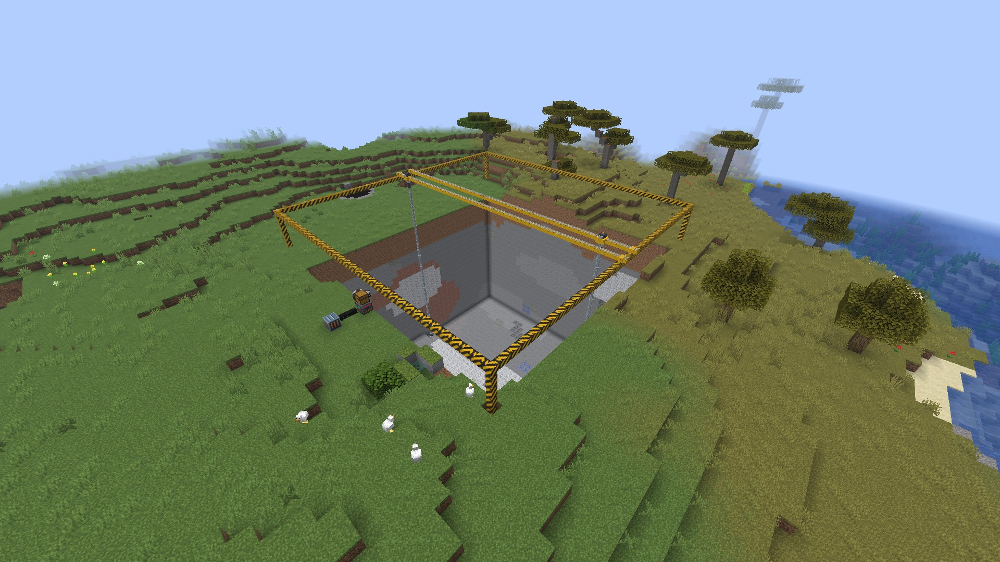
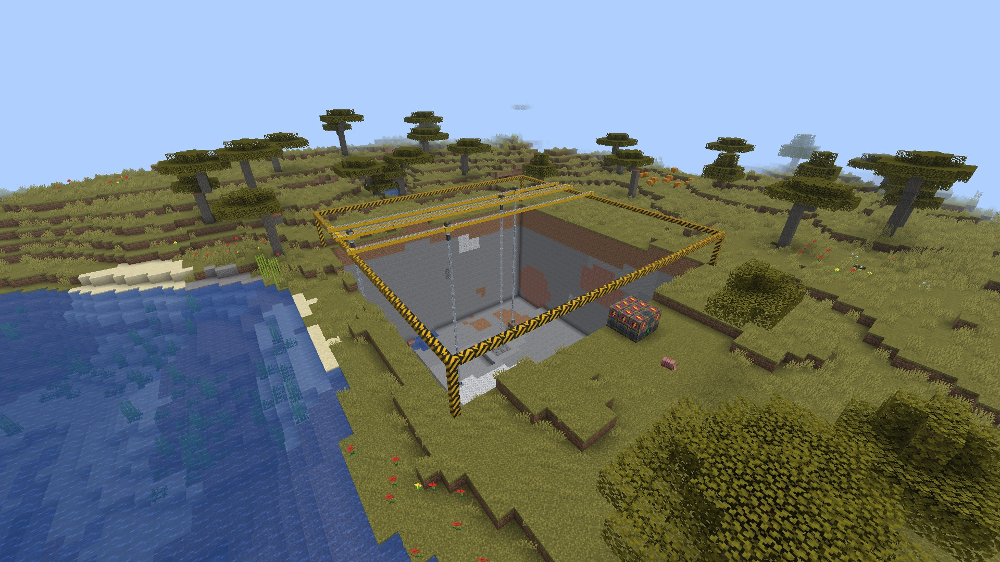
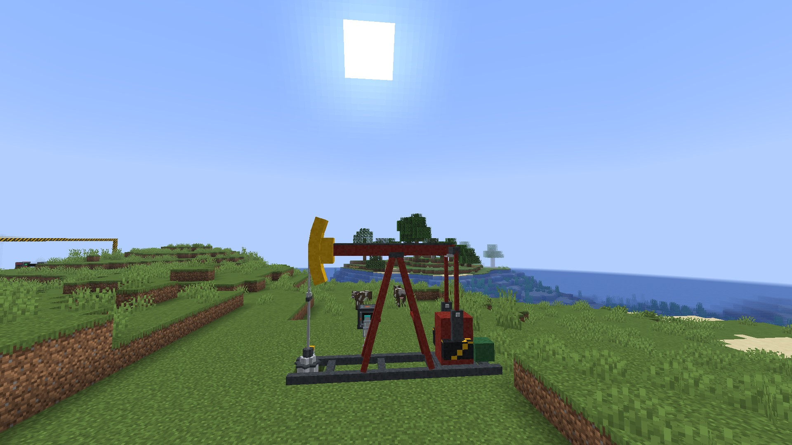
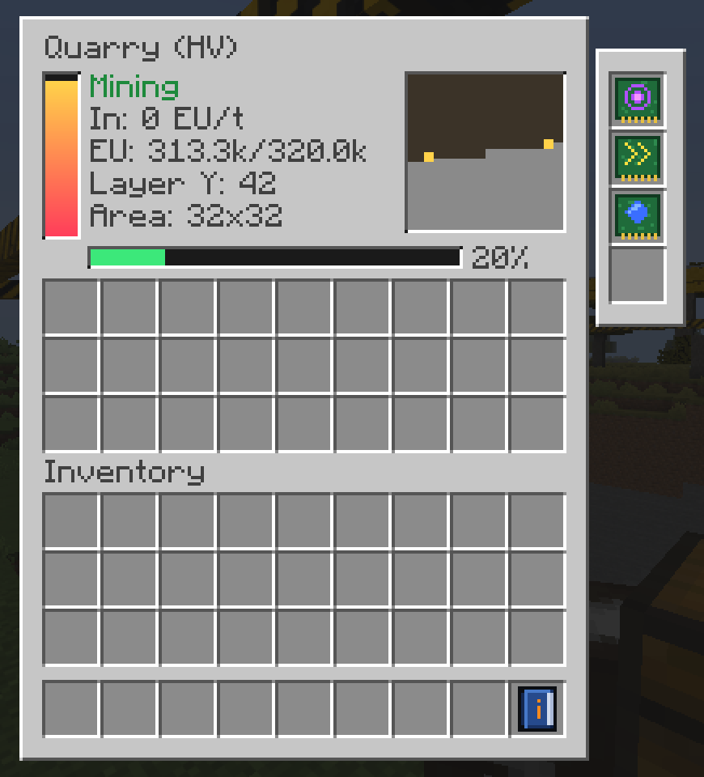

# Quarry Industrial

Mod de Fabric para **Minecraft 26.3**. Agrega quarries de minería automática que escalan desde una máquina LV
hasta una **quarry nuclear multibloque** alimentada por varios reactores, y **cigüeñas petroleras** (pumpjacks)
que extraen petróleo de los géiseres de [Ala Industrial](https://github.com/AlaMine-Team-Org/AlaIndustrial).

Funciona con energía **EU** a través de Team Reborn Energy. Se conecta solo con los cables, generadores y reactores
de Ala Industrial (y de Tech Reborn), sin depender de su código.



## Qué trae

### Quarries por tier

La quarry primero levanta un **pórtico** de vigas alrededor del área y después excava capa por capa, desde
debajo del pórtico hasta el fondo del mundo. Sobre el pórtico corre un puente con un carro, y del carro cuelga
una **sarta de perforación** (kelly, tubos con tool joints) que termina en una **broca tricónica** con conos que
giran sobre su propio eje.

| Tier | Bloque | Entrada | Área (base → máx.) | Cabezales | Bloques/s máx. |
|---|---|---|---|---|---|
| LV | Quarry (LV) | 32 EU/t | 9×9 → 16×16 | 1 | 5 |
| MV | Quarry (MV) | 128 EU/t | 16×16 → 48×48 | 1 | 20 |
| HV | Quarry (HV) | 512 EU/t | 32×32 → 80×80 | 2 | 60 |
| Nuclear | Núcleo + cubo 3×3×3 | 512 EU/t **por puerto** (1–8) | 64×64 → 144×144 | 4 | 400 |

- **La velocidad sale de la energía:** cada bloque cuesta `50 × (1 + dureza)` EU (más con upgrades). Una quarry
  con poca energía simplemente mina más lento.
- **Los drops** van a un buffer interno de 27 slots, que se vacía solo en cualquier cofre o tubería pegado a la
  quarry. Si se llena, la quarry se pausa.
- **Rompe como un jugador falso** con el UUID del dueño, así que respeta los mods de claims/protección.
- **Mantiene cargados** solo el chunk de la quarry y los de los cabezales.
- **No se inunda:** el agua o lava que encuentra dentro del área se borra, y la que está pegada al borde por
  afuera se tapa con un dique de adoquín.

### Quarry nuclear (multibloque)

Los cables más gruesos de Ala Industrial (electrum, HV) y sus reactores llegan a **512 EU/t**. Para escalar más
allá, la quarry nuclear tiene **puertos de energía**: cada uno recibe su propio cable, uno por reactor.

1. Poné el **Núcleo de quarry nuclear** mirando hacia vos.
2. Detrás de él, armá un cubo de **3×3×3**: el núcleo va en el centro de la cara delantera y las otras 26
   posiciones son **Carcasa de quarry** o **Puerto de energía (HV)** (de 1 a 8 puertos).
3. Si falta algo, la quarry muestra un **holograma** de los bloques que faltan.

El área a minar empieza detrás del cubo. La quarry nuclear usa una **broca PDC** (aletas con cortadores de
diamante) en vez de la tricónica.



### Cigüeña petrolera (pumpjack)

Los géiseres de petróleo de Ala Industrial tienen un caño de 1×1 que baja a un domo lleno de crudo. La cigüeña se
pone **sobre la boca del géiser**, mirando hacia él (la estructura de 3×7×5 se arma hacia atrás):

- Mientras quede crudo real en el caño y en el domo, lo **vacía** (1 cubo por segundo, 500 EU el cubo).
- Con el domo vacío, sigue extrayendo **para siempre** a 10 mB/t por 32 EU/t, hasta ~30 mB/t con 4 upgrades de
  velocidad.
- El petróleo (`#c:oil`, o sea `alaindustrial:oil`) va a un tanque de 16 cubos. Los **caños de Ala** pegados a la
  base lo toman solos (la cigüeña es un origen de un solo sentido, no hace falta la llave); para entregarlo a un
  tanque de Ala, poné esa cara del caño en "insertar" con la llave, como con cualquier tanque.

El balancín, la cabeza de caballo, las bielas y las manivelas con contrapesos están animados con la cinemática
real de un mecanismo de 4 barras.



### Upgrades

Se ponen en el panel lateral de la GUI o con clic derecho sobre la quarry (agachado + clic saca el último).

| Upgrade | Efecto | Máx. |
|---|---|---|
| Área | +16 de lado (hasta el máximo del tier); rehace el marco | 3 |
| Velocidad | +50 % bloques/s, ×1.25 coste | 4 |
| Fortuna | Fortuna I–III en los drops, +50 % coste por nivel | 3 |
| Toque de seda | Drops con seda, ×2 coste (no se combina con fortuna) | 1 |
| Filtro (void) | Destruye piedra, tierra, grava, etc. (tag `quarryindustrial:void_filter`) | 1 |

La cigüeña solo acepta upgrades de velocidad.

### GUI

Energía, estado, EU/t de entrada (y por puerto en la nuclear), capa actual, avance, un **minimapa** de la capa
en curso con los cabezales, el buffer de salida y los upgrades.



## Compatibilidad

- **Requiere:** Fabric Loader, Fabric API. Team Reborn Energy viene incluido en el jar.
- **Recomendado:** Ala Industrial (cables, reactores, petróleo). Sin Ala el mod funciona igual con cualquier
  fuente de EU de Team Reborn Energy; las recetas cambian a ingredientes vanilla y la cigüeña queda inactiva
  porque no hay petróleo.
- **Recetas:** cada item tiene dos recetas y se carga la que corresponde: con Ala usan sus circuitos, carcasas y
  placas; sin Ala, equivalentes vanilla.

## Configuración

`config/quarryindustrial.json` se crea al primer arranque con todos los números: costes, entrada y área de cada
tier, velocidad, altura y coste del marco, chunk loading, y todo lo de la cigüeña (caudal, consumo, umbrales para
reconocer un géiser).

## Desarrollo

```bash
./gradlew build                 # compila y arma el jar en build/libs
./gradlew runClient             # cliente de desarrollo (con Ala Industrial cargado)
./gradlew runGameTest           # gametests de servidor (quarries, nuclear, cigüeña, recetas)
./gradlew runGameTest -PnoAla   # los mismos, sin Ala Industrial
./gradlew runClientGameTest     # pruebas visuales: abre el juego y saca capturas en build/run/clientGameTest
QUARRY_SHOWCASE=1 QUARRY_SHOWCASE_DIR=docs/screenshots ./gradlew runClientGameTest   # capturas de esta página
python tools/finish_showcase.py  # después del showcase: JPG para las capturas y recorte de la GUI
```

- Java 25, Gradle 9.8 (wrapper incluido), Fabric Loom 1.19.
- Ala Industrial se carga solo en runtime (`ala_version` en `gradle.properties`); el mod no compila contra sus clases.
- `tools/gen_textures.py`, `tools/gen_icon.py` y `tools/gen_recipes.py` generan texturas, ícono y recetas
  (requieren Python 3 con Pillow).
- El showcase arma las escenas en un mundo normal con semilla fija (`quarryindustrial`) y saca las capturas en
  1920×1080 sin HUD; tarda unos 4 minutos.

### Estructura

| Carpeta | Qué hay |
|---|---|
| `src/main/.../block/quarry` | Quarries, marco, multibloque nuclear, GUI (menú) |
| `src/main/.../block/pumpjack` | Cigüeña, validador del pozo, partes del multibloque |
| `src/client/.../render` | Renderers y modelos 3D (pórtico, broca tricónica y PDC, cigüeña) |
| `src/client/.../screen` | Pantalla de la quarry |
| `src/gametest` | Gametests de servidor y pruebas visuales de cliente |
| `docs/` | Capturas y material para CurseForge |

## Licencia

Todos los derechos reservados (ver `LICENSE.txt`). Ala Industrial es de AlaMine Team (MIT) y no se redistribuye
con este mod.
